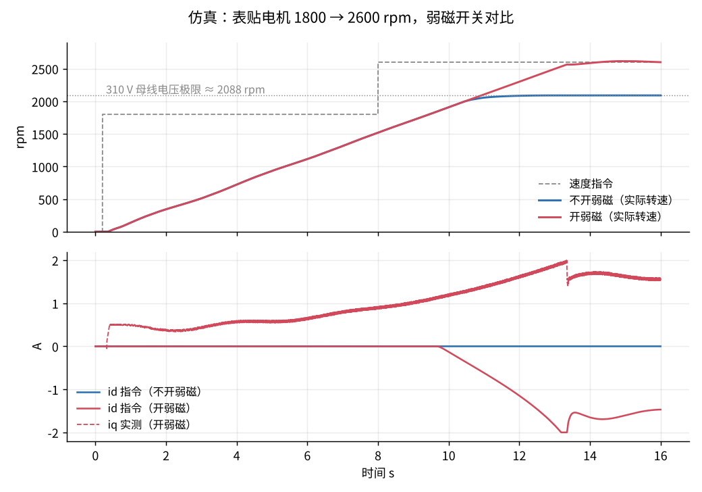
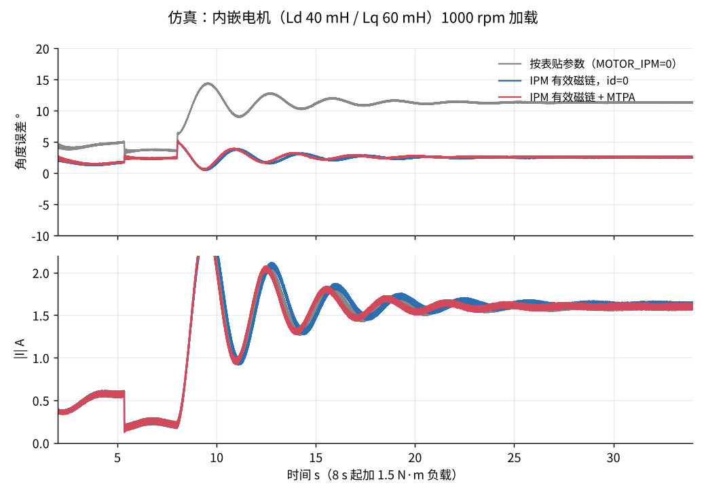

# flux_framework 重构说明（P1 + P2）

> 对应 tag `p2-mtpa-fw`，固件标识 `gFluxDiag.buildTag = 0xF20E0002`。
> 原工程 `flux_selfpll` 没有改动；本工程第一个提交 `base-test33` 是 test33 的原样拷贝，之后每一步都能用 `git diff` 看到改了什么。

## 0. 结论

1. **默认配置下，新代码与 test33 的行为逐位相同。** 证据在第 7 节：
   - 主机仿真把新旧两份代码接到同一个闭源库模型和同一个电机模型上，跑了 44 组工况。
   - 每拍对 FOC、USER、pwm_gen、PWM 寄存器、状态机和观测器的全部状态取哈希，结果全部相同。
   - 观测器加 PLL 另用随机输入跑了 200 万拍，同样逐位相同。
2. **框架已经按模块拆开。**
   - 换驱动板，只改 HAL。
   - 换电机，只改 `cfg_motor.h`。
   - 调性能，只改 `cfg_ctrl.h`。这里填的是 Hz 和阻尼，定点增益由编译器自动算出。
3. **MTPA、弱磁、内嵌式（IPM）有效磁链观测都写好了，默认全关。** 在仿真里都验证过：
   - 弱磁：310 V 母线下，不开弱磁转速卡在 2091 rpm；开弱磁后到 2600 rpm。
   - IPM 有效磁链：内嵌电机的角度误差从 11° 降到 2.5°。
   - MTPA：给出的 id 与公式一致。
4. **没做到的：**
   - 我无法用 Keil/armcc 编译，也不能上台架。用 clang 做了 Cortex-M0+ 32 位语法检查，0 告警。
   - 第一步请你在 Keil 里编译，然后按 `台架验收清单.md` 和 test33 对比。

## 1. 目录

```
flux_framework/
├─ FW/                     ← 新框架，所有算法代码都在这里
│  ├─ Inc/  cfg_board.h  cfg_motor.h  cfg_ctrl.h  fw_config.h   ← 参数（见第 5 节）
│  │        hal.h  foc_core.h  flux_obs.h  flux_pll.h  est.h  startup.h
│  │        speed_ctrl.h  mtpa_fw.h  supervisor.h  identify.h  diag.h  mathx.h
│  │        vendor_lib.h  ctrl_globals.h
│  └─ Src/  对应的 .c，加 main.c
├─ Board/                  ← 原 Main/，只剩驱动板外设初始化（SC_Init.c、Hardware_config.h、SC_Init.h、basic.h）
├─ User/Inc/               ← 只留闭源库需要的 ABI 头文件（motor_structure.h、includes.h、SC_it.h、FOC_PMSM.h 转接头）
├─ MCI/  Device/  CMSIS/   ← 原厂库、外设库、启动文件，原样
├─ Project/                ← Keil 工程（分组已改，见第 9 节）
├─ tools/                  ← 工程文件生成脚本 + 主机仿真与验证（tools/sim/README.md）
└─ docs/                   ← 仿真图
```

## 2. 模块地图

| 模块 | 文件 | 做什么 | 跑在 |
|---|---|---|---|
| config | cfg_board.h / cfg_motor.h / cfg_ctrl.h / fw_config.h | 物理单位参数 → 定点常量 | 编译期 |
| hal | hal_sc32r602.c、Board/ | ADC 采样与零点校准、PWM 写寄存器、桥臂开关、中断入口 | 快环 |
| foc_core | foc_core.c | Clarke/Park、电流环（调原厂库）、SVPWM、电压重建 | 快环 |
| flux_obs | flux_obs.c | 磁链观测器：电压模型 + 去直流 + NLFO；IPM 用有效磁链 | 快环 |
| flux_pll | flux_pll.c | 磁链叉积鉴相 + 二阶 PLL，启动期速度下限 | 快环 |
| est | est.c | 把观测器和 PLL 串起来，给出 θ̂、ω̂；Startup 上报转速限幅 | 快环 |
| startup | startup.c | Charge / Calib（飞车检测）/ Align / Startup / Torqueloop | 快+慢 |
| speed_ctrl | speed_ctrl.c | 速度斜坡 + 速度 PI + 加速度前馈 + 母线电流限 | 慢环 |
| mtpa_fw | mtpa_fw.c | id 指令：MTPA + 弱磁，电流圆限幅 | 慢环 |
| supervisor | supervisor.c | 主状态机、子状态切换、保护、初始化编排 | 快+慢 |
| identify | identify.c | 参数辨识（**只有接口**，P3 实现） | — |
| diag | diag.c | ISR 计时、置信度、版本号 | 快+慢 |
| mathx | mathx.h/.c | Q15 工具、整数开方 | — |

依赖方向是单向的：`supervisor` → `startup / speed_ctrl / mtpa_fw / est` → `flux_obs / flux_pll / foc_core` → `hal / mathx / vendor_lib`。

唯一的反向调用是 `startup` 在条件满足时调用 `Sup_Switch*`。这是为了让调用顺序与原厂完全一致。

### 每拍调用链（Spin 状态）

```
ADC_IRQHandler                                       hal_sc32r602.c
 ├─ acquireSamples()        电流 / 母线 → FOC.sIabc、s16Vbus
 ├─ Ctrl_FastTick()                                  supervisor.c
 │   ├─ FluxObs_Capture()   抓上一拍的比较值（电压重建用）
 │   └─ M1_Run_Fast → M1_RunSpinFast
 │       ├─ FocCore_Clarke
 │       ├─ Est_SpinTick                             est.c
 │       │   ├─ FluxObs_UpdateFeedback → ψr          flux_obs.c
 │       │   ├─ FluxPLL_PhaseError / FluxPLL_Run → θ̂ flux_pll.c
 │       │   └─ CmdTheta、FluxFeedback.s16Speed
 │       ├─ FOC_Current_Controller（原厂电流环）      foc_core.c
 │       └─ FocCore_Modulate → PWM_GEN_calc → Update_PWM
 ├─ 每 16 拍置 USER.bSlowLoopFlag
 └─ Diag_IsrTiming
main() 轮询到标志 → Ctrl_SlowTick → M1_Run_Slow → M1_RunSpinSlow
   SpeedCtrl_SpinSlow → MtpaFw_Slow → 回退判断 → Var_Filt → MCF_ADV_Protect
```

## 3. 旧 → 新对照

### 文件

| test33 | flux_framework |
|---|---|
| Main/Inc/mc_customize.h | 拆成 FW/Inc/cfg_board.h、cfg_motor.h、cfg_ctrl.h；派生量在 fw_config.h |
| User/Inc/FluxConfig.h | 并入 cfg_ctrl.h（可调量）和 fw_config.h（派生量、版本号） |
| User/Src/SC_it.c | FW/Src/hal_sc32r602.c |
| User/Src/FOC_PMSM.c | FOC_Current_Controller → foc_core.c；PMSM_Obs → est.c 的 Est_SpinTick |
| User/Src/FluxObs.c | FW/Src/flux_obs.c（voltage() → foc_core.h 的 FocCore_VoltageFromCompares） |
| User/Src/FluxPLL.c | FW/Src/flux_pll.c |
| User/Src/StateMachine.c | supervisor.c（状态机、切换、保护）+ startup.c（启动各子状态）+ speed_ctrl.c（速度环）+ est.c |
| Main/Src/user_function.c | Init_Parameter → Ctrl_Init（各模块的 *_Init）；variable_reset → Ctrl_ResetRunVariables；PWM_GEN_init / Update_PWM → hal |
| Main/Src/main.c | FW/Src/main.c |
| Main/Src/SC_Init.c 等 | Board/（内容未改，Hardware_config.h 只把 include 换成 cfg_board.h） |

### 函数

| test33 | 新 |
|---|---|
| M1_RunChargeFast / Slow | Startup_ChargeFast / Slow |
| M1_RunCalibFast / Slow | Startup_CalibFast / Slow |
| M1_RunAlignFast / Slow | Startup_AlignFast / Slow |
| M1_RunStartupFast / Slow | Startup_StartupFast / Slow（观测器 + PLL 部分在 Est_StartupTick、Est_StartupReportSpeed） |
| M1_RunTorqueloopFast / Slow | Startup_TorqueloopFast / Slow |
| M1_RunSpinFast / Slow | supervisor.c 同名（速度环部分在 SpeedCtrl_SpinSlow） |
| M1_Switch* | Sup_Switch*（ChargeCalib、CalibAlign、CalibTorqueloop、AlignStartup、StartupSpin、TorqueloopSpin、SpinStartup）；RunFault/RunStop 等仍在 supervisor.c 内部 |
| M1_AccFFAtSpinEntry | speed_ctrl.c 的 accFFAtSpinEntry，在 SpeedCtrl_OnEnterSpin 里用 |
| FluxObs_* / FluxPLL_* | 同名保留，新增 FluxPLL_PhaseError、FluxObs_TargetMag、FluxObs_SetIdRef（IPM） |
| FluxObs_Timing | Diag_IsrTiming |

### 宏（改了名的）

| test33 | 新 | 备注 |
|---|---|---|
| Rs / Ls / POLEPAIRS | MOTOR_RS_OHM / MOTOR_LD_H、MOTOR_LQ_H / MOTOR_POLE_PAIRS | Ls 拆成 Ld、Lq（表贴相等）；POLEPAIRS 保留别名 |
| FLUX_NOMINAL_WB | MOTOR_PSI_F_WB | |
| SPEED_ACC_PER_A | MOTOR_ACC_RPM_S_PER_A | 属于电机参数 |
| CURRENT_KP / KI | 由 CURRENT_BW_HZ 算出 CURRENT_KP_D/KI_D/KP_Q/KI_Q | d 轴用 Ld，q 轴用 Lq |
| SPEED_KP / KI | 由 SPEED_WN_HZ、SPEED_ZETA 算出 | 宏名不变 |
| FLUXPLL_KP/KI_Q31_PER_ERR | 由 FLUXPLL_WN_HZ、FLUXPLL_ZETA 算出 | 宏名不变 |
| FLUX_STARTUP_ACC_LIMIT | STARTUP_REPORT_ACC_LIMIT | |
| Q31(0.004)（写死在代码里） | STARTUP_PLL_FLOOR_RPM 12.8 → STARTUP_PLL_FLOOR_Q31 | |
| FLYCURRENT_TH | FLYCURRENT_TH_PU | |
| SPEED_OC_THRESHOLD | SPEED_OC_RATIO | |
| IBUS_LIMIT_VALUE / SPEED_LIMIT_VALUE | 由 IBUS_LIMIT_A / POWER_LIMIT_SPEED_RPM 算出 | |
| sEalAvgMA.u16Sh = 12（写死） | FLUX_HPF_SH | |
| FLUXPLL_BUILD_TAG | FW_BUILD_TAG（旧名保留为别名） | |

### 全局变量

- 以下名字都没变，J-Scope 和 Keil Watch 照旧能用：
  - 闭源库要求的 `FOC`、`USER`、`FastBoot_Para`、`pwm_gen`、`eM1_MainState`、`eM1_RunSubState`、`M1FaultID(_Record)`、`ADC_DMABuff`
  - 诊断用的 `sFluxObs`、`gFluxDiag`、`gFluxPLLDiag`、`Target_Speed`、`Run_*_Target_*`
  - 只是地址变了，J-Scope 工程要重新生成。
- 删掉的（都是只写不读）：`NewStartUpPhaselessTime`、`s16PosElEst_Flux`（与 FOC.s16CmdTheta 相同）、`ReverseFlag`、`hRemainder`、`u32FGPeriod`、`u16AbsSpdfilt`、`HoldTime`、`PeriodTime`。
- 改成文件内 static 的：`u16Cnt`、`u32IaSum` 等零点校准变量，`NewStartUpBlockTime`、`NewStartUpCloseTime`、`Bemf_Check_cnt`。
- 新增：
  - `gMtpaFw`：idMtpa、idFw、idCmd、iqLimit、vRatio
  - `gFluxDiag.cfgWarn`、`gFluxDiag.confidence`
  - `gIdent`：辨识，暂未实现

## 4. 已实现 / 只有接口 / 待做

| 项 | 状态 |
|---|---|
| 模块化框架、物理单位参数体系 | ✅ 完成，默认行为 = test33 |
| 表贴电机磁链观测 + PLL（原 test33 算法） | ✅ |
| 内嵌电机有效磁链观测（MOTOR_IPM=1） | ✅ 仿真验证，未上台架 |
| MTPA（CTRL_MTPA_ENABLE） | ✅ 仿真验证，未上台架；只有 IPM 有收益 |
| 弱磁（CTRL_FW_ENABLE） | ✅ 仿真验证，未上台架；SPM/IPM 都能用 |
| 观测器置信度 gFluxDiag.confidence | ✅ 只做诊断，没有参与切换（原厂的 80 rpm 切换判据未动） |
| 参数自动辨识 identify | ⬜ 只有接口和方法说明（P3） |
| IPD 初始位置检测 + I/f + 磁链接管（零速带载启动） | ⬜ 未做（P4） |
| HFI 高频注入 | ⬜ 未做（P4，IPM 才有意义） |
| 电流环 dq 解耦前馈 | ⬜ 未做（高速弱磁区可能需要，见第 8 节） |
| 换板/换电机实测 | ⬜ P6 |

## 5. 参数：换电机 / 换驱动板改哪里

### 换电机（同一块驱动板）

1. 填 `cfg_motor.h`：
   - `MOTOR_IPM`（表贴 0，内嵌 1）
   - `MOTOR_POLE_PAIRS`
   - `MOTOR_RS_OHM`
   - `MOTOR_LD_H`、`MOTOR_LQ_H`
   - `MOTOR_PSI_F_WB`
   - `MOTOR_ACC_RPM_S_PER_A`
   - `SPEED_MAX`（比最高转速大一些）
2. `MOTOR_ACC_RPM_S_PER_A` 不知道时，先粗估：
   - 公式：`1.5·p·ψf / J × 60/(2π)`
   - 或者第一次上电只跑开环加速，用"iq 和加速度的比"来测。
   - 它只影响速度环增益和加速度前馈。估大了，速度环会偏软。
3. **其他都不用动**：
   - 电流环、PLL、速度环的增益随电机参数自动重算，目标带宽保持不变。
   - 观测器常数在初始化时算。
4. 上电后在 Watch 里核对三组值：
   - `FOC.CurID.qKp`
   - `FOC.sPLL.s16PGain/s16IGain`
   - `FOC.Speed.qKp/qKi`
   - 如果某个是 0 或 32767，说明参数超出定点范围，告诉我。
5. **启动参数**（`cfg_ctrl.h` 启动段：`IQ_STARTUP`、`STARTUP_TO_SPIN_SPEED` 等）是原厂按这台风机定的，换电机后可能要改。

### 换驱动板

- 改 `cfg_board.h`：采样电阻、运放增益、母线分压满量程、PWM 频率、死区、相序 `RUN_DIR`。
- 改 `Board/`：外设初始化、引脚、ADC 通道。
- 改 `hal_sc32r602.c`：电流采样符号、PWM 通道映射。
- 算法文件一个都不用碰。

### 调性能（cfg_ctrl.h）

| 想改什么 | 改哪个 | 现值 | 说明 |
|---|---|---|---|
| 电流环带宽 | CURRENT_BW_HZ | 86.573 Hz | 原厂值反算 |
| 速度环带宽/阻尼 | SPEED_WN_HZ / SPEED_ZETA | 0.31 Hz / 0.078 | 原厂值反算。**阻尼极小**，台架上的 3.2 s 振荡和 +80~110 rpm 过冲就是它造成的。建议台架上试 ζ = 0.5~0.7 |
| PLL 带宽/阻尼 | FLUXPLL_WN_HZ / FLUXPLL_ZETA | 14.35 Hz / 0.677 | test33 的 25583/106 |
| 加速度前馈 | SPEED_ACC_FF_ENABLE | 1 | |
| 弱磁 | CTRL_FW_ENABLE、FW_VOLTAGE_MARGIN、FW_KI_A_PER_S、FW_ID_MIN_A | 关 / 8% / 50 A/s / −2 A | |
| MTPA | CTRL_MTPA_ENABLE | 关 | 只在 MOTOR_IPM=1 时起作用 |

## 6. 增益对照（fw_config.h 自动算 vs test33 常量）

`tools/sim/build/gain_check` 打印的结果。取整方式与原厂 `Q15()` 一样，都是截断。

| 常量 | 物理规格 | 精确值 | 取整 | test33 |
|---|---|---|---|---|
| CURRENT_KP_D / _Q | BW 86.573 Hz × L 46 mH | 13747.55 | 13747 | 13747 |
| CURRENT_KI_D / _Q | BW 86.573 Hz × Rs 14.7 Ω | 274.58 | 274 | 274 |
| SPEED_KP | ωn 0.3105 Hz，ζ 0.078025，b 501 rpm/s/A | 8000.53 | 8000 | 8000 |
| SPEED_KI | 同上 | 100.02 | 100 | 100 |
| FLUXPLL_KP_Q31_PER_ERR | ωn 14.346 Hz，ζ 0.676628，ψf 0.141 Wb | 25583.48 | 25583 | 25583 |
| FLUXPLL_KI_Q31_PER_ERR | 同上 | 106.51 | 106 | 106 |
| SPEED_ACC_FF_IQ | 200 rpm/s ÷ 501 | — | 1642 | 1642 |
| STARTUP_PLL_FLOOR_Q31 | 12.8 rpm | — | 8589934 | Q31(0.004) |
| FLUX_STARTUP_ACC_STEP | 1000 rpm/s | — | 41943 | 41943 |
| FLUX_NOMINAL_Q15 | 0.141 Wb | — | 6111 | 6111 |

反算出来有两个物理结论：

- 原厂电流环是零极点对消设计，Ki/Kp 正好等于 Rs/L。
- 原厂速度环的阻尼 ζ = 0.078，这正是"3.2 s 周期振荡"的来源。按辨识出的被控对象算出的周期也是 3.2 s。

## 7. 验证

### 7.1 方法

我没有 Keil 和板子，所以验证分三层：

1. **新旧逐位对比（主机仿真，`tools/sim`）**
   - 闭源库模型：按 test33 的 AXF 反汇编，把库函数逐条翻译成 C。函数包括 CalcPI、Fast_Boot_*、Var_Filt、PWM_GEN_calc、MCF_ADV_Protect、MCF_FlyStart_2R、MLIB_SinCos/Sqrt_Q15 的查表等，查表数据直接从 AXF 里取。
   - 电机 + 逆变器 + ADC 模型：dq 模型，板级相序与固件一致，带死区电压误差、ADC 量化与噪声、风机负载和摩擦。
   - 把 test33 原代码（从 git tag `base-test33` 导出）和新代码各自接上这两个模型，用同一组输入跑。
   - 每拍对下列状态取哈希：`FOC`、`USER`、`pwm_gen`、PWM 寄存器、两个状态变量、观测器全部状态、PLL 诊断、故障字。
2. **观测器 + PLL 随机输入**：200 万拍，覆盖坏采样复位、输入饱和、磁链饱和、PLL 速度饱和、启动下限、BeginStartup。
3. **ARM 32 位语法检查**：用 clang 以 `thumbv6m`（Cortex-M0+）目标检查 Keil 工程里全部 42 个 .c，FW/ 下开 `-Wall -Wextra`。

### 7.2 结果

- 逐位对比：**45/45 相同**，包括随机输入那一组。44 组闭环工况覆盖：
  - 冷启动成功和失败（堵转故障后自动重启）
  - 转子不同初始角
  - 0 / 0.2 / 0.4 µs 死区误差
  - 正转 → 反转 → 停 → 飞车启动
  - 启停循环
  - 高速正反转硬切
  - 堵转
  - 母线 150 V
  - 加载 0.3 和 1.5 N·m
  - 2600 rpm 指令
- 突变测试：把 `FLUX_NLFO_SH` 改成 10、`SPEED_ZETA` 改一位，对比分别在第 5159 拍和第 0 拍报不同。说明这个对比能抓到微小差异。
- 新功能（仿真，图在 docs/）：



- 弱磁：
  - 不开时转速停在 2091 rpm，正好是 310 V 母线的理论电压极限 2088 rpm。
  - 开了以后到 2602 rpm，id ≈ −1.47 A，θ̂ 误差 4.9°，转速波动 ±7.7 rpm。



- 内嵌电机（Ld 40 mH、Lq 60 mH），1000 rpm 加 1.5 N·m 负载：

  | 配置 | 角度误差 | id | \|I\| |
  |---|---|---|---|
  | 按表贴参数跑（`MOTOR_IPM=0`） | 11.3° | — | 1.597 A |
  | 有效磁链（`MOTOR_IPM=1`） | 2.5° | 0 | 1.621 A |
  | 有效磁链 + MTPA | 2.6° | −0.33 A | 1.600 A |

  MTPA 给出的 id 与解析公式完全一致。

### 7.3 局限

- **仿真里的电机不是你的电机。** 它只用来证明"新旧一样"和"新功能逻辑对"，绝对性能以台架为准。
  - 比如这个模型下冷启动有一部分会打滑失败，和台架上 test29/33 的低速打滑现象类似，但比例不能直接对比。
- 闭源库模型是我按反汇编翻译的。它只影响"仿真像不像真机"，不影响"新旧是否一样"：两份代码接的是同一个模型。
- **Keil/armcc 编译没做。** clang 能抓语法和类型问题，但 armcc 的告警、链接、代码大小、ISR 实际耗时都要你在 Keil 里确认。

## 8. 与 test33 的全部差异（默认配置下都不影响行为）

1. 删掉 `FAST_BOOT_METHOD = 0` 分支，改成 `#error`。test33 里这一分支的切换代码本来就整段注释掉了，选它只会永远卡在 Startup。同时删掉 `FOC_Current_Controller` 的 `#else` 分支（里面有 `Vq = 1000` 的调试残留）。
2. 删掉只写不读的变量（第 3 节）。
3. `FW_BUILD_TAG = 0xF20E0002`。
4. `gFluxDiag` 末尾新增 `cfgWarn`、`confidence`。`Diag_SlowTick` 每个慢环拍做一次除法，在主循环里，不进中断。
5. 快环多了一层函数调用（`Ctrl_FastTick`）。热路径上的 Clarke、电压重建、PWM 使能检查已改成内联。估计 ISR 多 1 µs 以内，**请在台架上看 `gFluxDiag.isrMax`**（test29：1511 counts）。

## 9. 已知风险 / 要你确认的

| # | 风险 | 怎么确认 / 应对 |
|---|---|---|
| 1 | armcc 编译问题。头文件里用了 `static __forceinline`，与原厂 mlib.h 同一写法；mtpa_fw.c、mathx.c 有 `int64_t` | Keil 全编译，0 error。有 error 把输出发我 |
| 2 | Keil 工程：分组改成 Config / App / Control / Observer / FOC_Core / HAL_Board / Device / Startup / MCI，Include 路径加了 `..\FW\Inc`、`..\Board\Inc`，输出仍是 `..\Output\SOC_FOC_SDK_V1_0.axf` | 打开工程看分组；`.uvoptx`（调试器、Watch 设置）从 flux_selfpll 复制，并按新文件表重新生成了分组 |
| 3 | ISR 耗时变化 | 看 `gFluxDiag.isrMax / overBudget` |
| 4 | J-Scope 地址全变 | 用新 AXF 重新生成 jscope，变量名与 v23 相同（见清单） |
| 5 | 弱磁没有电流环 dq 解耦前馈 | 原厂电流环没有解耦。高速弱磁时 d/q 耦合靠 PI 扛，仿真里够用；台架上 id/iq 振荡就加解耦 |
| 6 | 弱磁会改速度 PI 的输出限幅（电流圆） | 只在 `CTRL_FW_ENABLE=1` 时发生；回退和停机时恢复 |
| 7 | IPM 观测器的幅值目标用的是 id **指令**，不是实测值 | id 变化慢（1 kHz），影响小；台架上看 `gFluxDiag.confidence` |
| 8 | MTPA/弱磁/IPM 都没上过台架 | 默认全关，先确认重构本身没问题，再逐个打开 |

## 10. tools/

- `tools/update_uvprojx.py`：按脚本里的分组表重写 Keil 工程的文件分组和 Include 路径，并校验所有文件都存在。加了新 .c 就改表、跑一下。
- `tools/update_uvoptx.py`：让 `.uvoptx` 的文件表与 `.uvprojx` 一致，调试设置原样保留。
- `tools/sim/`：主机仿真与全部验证，见 `tools/sim/README.md`。需要 Linux 或 WSL（gcc、clang、python3）。

## 11. 下一步（框架文档的 P3~P6）

1. **先过 `台架验收清单.md` 的第 1~3 步**，确认重构不改变行为。
2. P5 的弱磁可以接着就试：`CTRL_FW_ENABLE=1`，2000 → 2400 rpm，清单第 4 步。
3. P3 参数辨识：先做 Rs 和死区电压（Align 位置打两档直流），这两个对低速观测器最关键。
4. P4 IPD + I/f：解决零速带载启动和低速打滑。
5. 速度环阻尼（`SPEED_ZETA` 0.078 → 0.5~0.7）：只改一行，建议尽早在台架上试，收益可能比 MTPA 大得多。
