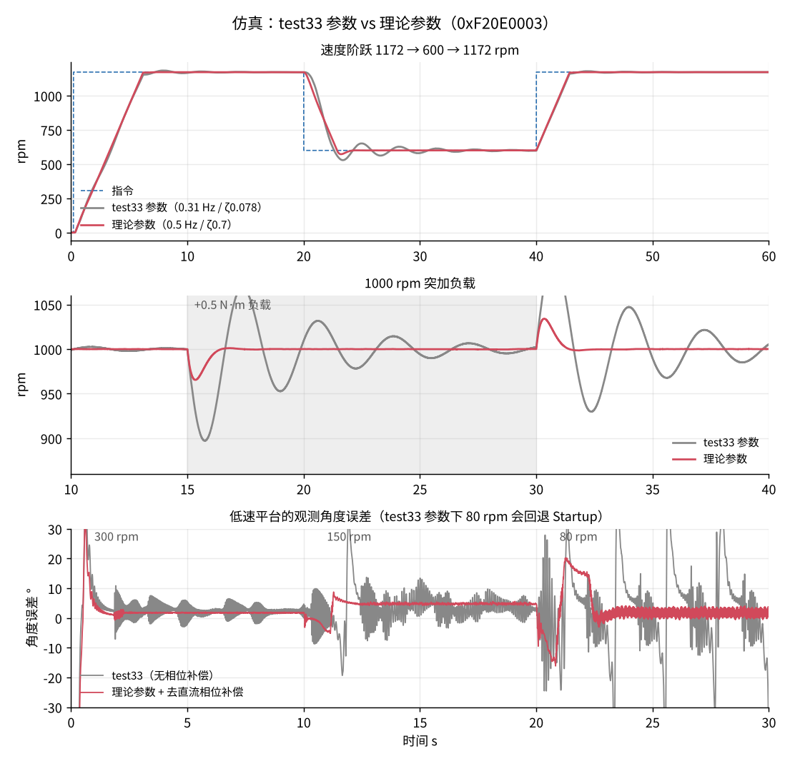

# flux_framework 重构说明

> 当前固件标识 `gFluxDiag.buildTag = 0xF20E0006`。
> 原工程 `flux_selfpll` 没有改动。本仓库第一个提交（tag `base-test33`）是 test33 的原样拷贝，之后每一步都能用 `git diff` 看到改了什么。

| 版本 | tag / 提交 | 内容 |
|---|---|---|
| 0xF20E0001 | `p1-refactor` | 模块化重构，行为与 test33 逐位相同 |
| 0xF20E0002 | `p2-mtpa-fw` | + MTPA、弱磁、IPM 有效磁链（默认关），行为仍与 test33 相同 |
| 0xF20E0003 | `p3-theory` | 按理论取参：电流环 300 Hz + dq 解耦，速度环 0.5 Hz / ζ0.7，PLL 15 Hz / 0.707，自写防溢出 PI，观测器去直流相位补偿，电流零点 256 点 |
| 0xF20E0004 | `p4-review` | 代码审核后的修复：I/F 开环启动（可切回原厂）、相位补偿只在 Spin、角度时序补偿、PLL 增益溢出检查、POWER_LOOP 限幅、解耦切换移进快环、反转五段式。见第 0.1 节 |
| 0xF20E0005 | `p5-align1`（台架验证：`bench-0xF20E0005`） | I/F 定位改成一段（0°，最短 0.8 s，等停稳），`IF_ALIGN_STAGES = 2` 可切回两段；停稳门限 5 → 8 rpm。见第 0.1 节末尾 |
| 0xF20E0006 | master | **去掉原厂闭源库**，库里的函数全部自写，行为与 0xF20E0005 逐位相同。见第 0.2 节 |

## 0. 结论

1. **框架按模块拆开了。**
   - 换驱动板只改 HAL。
   - 换电机只改 `cfg_motor.h`。
   - 调性能只改 `cfg_ctrl.h`：填 Hz 和阻尼，定点增益由编译器自动算出。
2. **参数不再沿用原厂，按理论取值（0xF20E0003）。** 每一项都有单独开关，或者是一个物理量，注释里写了原厂值。全部改回原厂值（`tools/sim/legacy_cfg.sh`）后，与 test33 **逐位相同**：45 组仿真，每拍比较全部状态。
3. **仿真里理论参数明显更好（第 7 节）：**

   | 指标 | test33 参数 | 理论参数 |
   |---|---|---|
   | 1172→600 rpm 下冲 | 71 rpm | 28 rpm |
   | 1172→600 rpm 调节时间 | 11.8 s | 3.7 s |
   | 突加 0.5 N·m 掉速 | 103 rpm | 35 rpm |
   | 突加负载后恢复 | 7.4 s | 0.7 s |
   | 80 rpm 运行 | 撑不住，回退 Startup | 稳住，角度误差 1.7° |
   | 冷启动成功（128 组，0xF20E0004 I/F） | 78 | 128 |
   | 冷启动成功（144 组压力工况，0xF20E0004 I/F） | 17 | 142 |

   0xF20E0003 版报的"冷启动 78 → 96"不可靠（那组只扫了 0~0.4 µs 死区），已撤回，见第 0.1 节。

4. **MTPA、弱磁、IPM 有效磁链观测都写好了，默认关。** 仿真结果：
   - 弱磁：310 V 母线下能到 2600 rpm。
   - IPM：内嵌电机的角度误差从 11° 降到 2°。
5. **没做到的：**
   - 不能用 Keil/armcc 编译，也不能上台架。用 clang 做了 Cortex-M0+ 32 位语法检查，0 告警。
   - **仿真里的电机不是你的电机**，上面的数字说明方向，不代表台架上的绝对值。请按 `台架验收清单.md` 验证。

## 0.1 代码审核（0xF20E0004）

0xF20E0003 之后做了一次独立审核：通读代码，并给仿真加了压力开关（PWM 晚一拍生效、ADC 噪声、Rs/L/ψf/J 失配、死区 0~1.2 µs，见 `tools/sim/README.md`）。

### 审核发现与处理

| # | 发现 | 严重度 | 处理 |
|---|---|---|---|
| 1 | **原厂启动本身不稳**（test33 也一样）：观测器从第一拍就闭环，10 rpm 时反电势约 0.7 V，死区/电阻误差约 3 V。成功率随死区、Rs 在 0/8~8/8 之间乱跳，Rs ±10% 就大面积失败（热机重启） | 高 | 加 I/F 开环启动，`STARTUP_MODE` 可切回原厂 |
| 2 | 去直流相位补偿在 Startup 期间用了虚高的 PLL 转速（55 rpm 对真实 10 rpm），补偿角是错的，把启动拖差（0xF20E0003 引入） | 高 | 只在 Spin 用 PLL 转速补偿；I/F 拖动时用开环转速；原厂 Startup / 飞车不补 |
| 3 | 角度时序（原厂结构）：Park 用 PLL 已推进一拍的角，反 Park 没有 1.5 拍延时补偿（`s16CmdTheta_Update` 算了没用）。2600 rpm 一拍 4.9° | 中 | `CTRL_ANGLE_COMP`：Park 用 θ(k)，反 Park 用 θ(k)+1.5ωTs。2600 rpm 弱磁角度误差 4.8° → −0.1° |
| 4 | 观测器电压对齐依赖 PWM 影子寄存器装载时刻，没核实 | 中 | 按你的意见暂不处理（仿真里 PWM 晚一拍时 2600 rpm 多 2.6°） |
| 5 | PLL 增益字段是 int16，`FLUXPLL_WN_HZ` > 17.6 Hz 或 ψf < 0.12 Wb 就回绕成负增益 | 中 | 封顶到 32767，`gFluxDiag.cfgWarn` bit2；反电势超电压基准 bit3 |
| 6 | POWER_LOOP + 开 MTPA/弱磁时，限幅写到了速度环上，破坏"速度环只限速" | 中 | 按外环类型写到产生 iq 的那个环 |
| 7 | 弱磁对电感误差敏感（L ±20% → 2600 rpm 角度误差 0~15°） | 中 | 记入风险，开弱磁前实测 L |
| 8 | 仿真偏乐观：比较值当拍生效、噪声小、死区小、慢环不被打断 | 中 | 加压力开关；控制环在所有压力工况下仍稳定且优于 test33 |
| 9 | 解耦开关在主循环里改积分器，和快环有竞争（最坏一拍 vq 少约 6 V） | 低 | 改成主循环发请求、快环在 PI 前执行；Startup→Spin 时先切状态再请求 |
| 10 | 注释"ζ0.7 过冲约 5%"不对：PI 带零点，阶跃过冲约 20%（实际有斜坡和前馈看不到） | 低 | 改注释 |
| 11 | 反转时永远七段式（原厂没取绝对值） | 低 | `CTRL_FIX_PWMMODE_ABS` |
| 12 | 从原厂 Startup 切进 Spin 的第一拍，鉴相用的 `s16ThetaPLL` 是旧值（原厂残留，影响很小） | 低 | 新时序路径改用 `s32Theta` |

### I/F 开环启动（`STARTUP_MODE = STARTUP_IF`，默认）

流程：

1. **定位**：d 轴电流斜坡到 0.6 A，加在 0°，至少 0.8 s，然后等转子停稳（反电势估计 < 8 rpm 持续 0.1 s，最长 2 s）。这是 0xF20E0005 的一段式；0xF20E0004 是两段式：先 120° 打 0.6 s，再 0.3 s 转到 0°，停稳门限 5 rpm。
2. **拖动**：电流 0.6 A 沿开环角方向，开环角以 100 rpm/s 加速到 150 rpm 并保持。观测器和 PLL 一直在跑，只是不用于控制。
3. **切闭环**：PLL 转速（滤波后）与开环转速相差 < 15%，持续 0.1 s，就按转矩不变切换：iq = I·sin(θ_ol − θ_est)，id = 0，进入 Spin。2 s 内一直不一致就报堵转，然后按原厂规则自动重启。
4. **低速区归 I/F 管**：指令反向或 |指令| < 60 rpm 时，Spin 减速到 250 rpm 就交还 I/F（转矩连续：θ_ol = θ_est + asin(iq/I)），由开环带过零、反向后再切闭环。|指令| < 60 rpm 时就以指令转速开环运行。
5. **飞车**：转子顺着指令方向转，照旧走原厂飞车启动。逆着转，就留在 Calib 继续下桥短接制动，短路电流低于门限（约 30 rpm）后按静止处理。

调试中踩到的四个坑都写进了注释，理由如下：

- **定位是无阻尼单摆**：本电机 J ≈ 0.02 kg·m²，0.6 A 下周期约 0.5 s，风机低速几乎没有摩擦。所以定位时用 q 轴反电势加阻尼电流（`IF_ALIGN_ZETA`）。
  - 反电势取 q 轴 PI 积分项减 Rs·iq，不取 PI 总输出：总输出里的 Kp·误差瞬态会让阻尼环振荡。
  - ζ 不能大：Rs 配置误差会构成正反馈，环路增益约 10·ζ·(Rs 误差)，0.25 时能容忍约 ±40%。
- **定位角必须在相轴上（0/60/120°…）**：在 30/90/150° 时有一相电流为 0，死区让这一相电压来回跳（零电流钳位），正好吞掉 q 轴反电势，阻尼环看不到转子在动。
- **第二段用慢转不用阶跃**：90° 阶跃会重新激起整幅摆动。
- **拖动电流沿开环角（d 轴）而不是 q 轴**：与定位电流方向连续，不会一上来满转矩踢一脚。

### 仿真结果（全部带 PWM 晚一拍）

| 工况 | test33 | 0xF20E0004 |
|---|---|---|
| 冷启动：死区 0~1.2 µs、Rs 0.8~1.3、噪声×4、L 0.7/1.4、ψf 0.9、J 0.5/2，每组 8 个初始角 | 17/144 | 142/144 |
| 冷启动：J ×1.3 / ×1.5 / ×1.7、J×1.5 + Rs×1.2 | — | 30/32 |
| 冷启动：原 128 组 | 78/128 | 128/128 |
| 冷启动到闭环用时 | 0.2~1.4 s | 约 3.0~3.5 s |
| 293→1172→600→−400→停（转子反转滑行中）→1000 | 8 次故障，最后停在 12 rpm | 0 次故障，最后 1000 rpm |
| ±1000 rpm 硬换向 → 300 | 5 次故障，最后 0 rpm | 0 次故障，最后 300 rpm |
| 80 rpm 闭环运行 | 撑不住 | 稳住，角度误差 1.7° |
| 2600 rpm 弱磁角度误差（PWM 当拍 / 晚一拍） | — | −0.1° / 2.6°（0xF20E0003：4.8° / 7.5°） |

### 0xF20E0005：定位改成一段

**台架反馈**：0xF20E0004 每次启动转子都先抖一下、往后退一下才开始转。
- "抖"是定位把转子从任意位置拉过来时的摆动，所有先定位再启动的方法都有。
- "退"是两段定位的第二段从 120° 转回 0°，正转时等于往反方向转了 120° 电角度（机械 24°）。

**为什么原来要两段**：一段定位有死点。转子正好在定位角对面 180° 附近时转矩几乎为零，看起来和"已对准"一样，程序分不出来。两段的两个定位角差 120°，转子不可能同时在两个死点上。

**决定**：改成一段（0°），接受小概率的死点失败。失败时报堵转，然后按原厂规则自动重启。

**仿真**（PWM 晚一拍、死区 0.6 µs，初始角按 2° 一档扫一个电周期，共 36 个）：

| 定位 | 第一次就成功 | 启动用时 | J ×2 时第一次就成功 |
|---|---|---|---|
| 两段（0xF20E0004） | — | 2.9~3.1 s | 约 6/8 |
| 一段，最短 0.5 s | 34/36（死点两侧 2 档各失败一次，重启后正常，6.7 s 进闭环） | 2.3~2.6 s | 19/36 |
| **一段，最短 0.8 s（采用）** | **36/36** | **2.6~2.8 s** | 23/36 |

**说明与限制**：
- 仿真里，死点附近的转子会被噪声推下死点，所以多等 0.3 s 就能救回来。真电机有静摩擦和齿槽力矩，可能卡住不动，台架上还是要按"约 6% 的位置会失败一次"来预期。
- 一段比两段更怕转动惯量配错：J ×2 时，第一次就成功从约 75% 降到 64%，但重启后基本都能转起来。
- 其余压力工况：144 组里 140 组成功（0xF20E0004 是 142 组），差的那几组都是 J ×2。原 128 组 128/128；反转冷启动 12/12；硬换向、全工况、反转滑行重启都没有故障。

### 已知限制

- **启动慢了**：约 3 s 才进闭环，原厂 0.2~1.4 s。启停周期短于 3 s 的工况（仿真工况 4：开 1.6 s / 关 0.9 s）永远进不了闭环。要更快可以加大 `IF_CURRENT_A`、`IF_ACC_RPM_S`，或缩短定位时间。
- **I/F 加速度要和转动惯量匹配**：J 比 `MOTOR_ACC_RPM_S_PER_A` 隐含的值大一倍时成功率降到 6/8。换风叶后要重新辨识 b。
- **减速制动时观测器在 200 rpm 以下失准**（死区，没做补偿），所以回退转速设在 250 rpm。
- **第 4 项（PWM 装载时刻）没核实。**

## 0.2 去掉原厂闭源库（0xF20E0006）

**原则**：原厂开源的代码（头文件、用户代码）可以用或参考；闭源的 `SOC_MCI_2R_V102.lib` 一律不调用，自己写。

**库里实际被用到的 10 个函数加 1 个全局变量，全部换掉了：**

| 原厂闭源 | 自写替代 | 文件 |
|---|---|---|
| `MLIB_SinCos` | `Mc_SinCos`（内联） | mc_math.h |
| `Sqrt_Q15` | `Mc_SqrtQ15`（内联，越界保护） | mc_math.h |
| `MLIB_Ramp_Q31` | `Mc_RampQ31`（内联） | mc_math.h |
| 正弦表、开方表 | 按公式生成：`round(32767·sin(i·90°/256))`、`floor(32767·√(i/512))` | tools/gen_tables.py → mc_tables.c |
| `PWM_GEN_calc`、`PWM_GEN_init`、全局 `pwm_gen` | `Svpwm_Calc`、`Svpwm_Init`、`pwm_gen` | svpwm.c |
| `DcBus_Ripple_suppress` | `FocCore_BusNormalize`（内联） | foc_core.h |
| `Var_Filt` | `Meas_SlowFilter`（母线为 0 时不除） | meas.c |
| `MCF_ADV_Protect` | `Protect_SpinSlow` | protect.c |
| `MCF_FlyStart_2R`（含 `MLIB_PLL`） | `FlyStart_CalibFast`，桥臂操作移到 `HAL_PwmShortLowSides` | flystart.c |
| `Fast_Boot_Spin` | `spinTooSlow`（文件内） | supervisor.c |
| `Fast_Boot_StartUp` | `vendorStartupDone`（文件内，只在原厂启动模式） | startup.c |
| `CalcPI`、`Fast_Boot_Current_Controller` | 早已自写（ctrl_pi.h、`FocCore_DqPI`），原厂路径和 `CTRL_OWN_PI` 选项删除 | — |
| `MCF_FlyStart_0BEMF` | 库里本来就是空函数，`FLY_CHECK_0BEMF` 选项删除 | — |

另外 `Update_PWM` 改名 `HAL_PwmWriteCompares`，`vendor_lib.h` 改名 `mc_types.h`；`MCI/Src/SOC_MCI_2R_V102.lib` 从工程和仓库里删除（需要时从 tag `bench-0xF20E0005` 取）。

**还在用的原厂开源部分**（源码可见）：
- `mlib_types.h / mlib.h`：Q15 类型和内联函数，例如 `MLIB_Mul_Q15`、`MLIB_FilterMA_Q15`。
- `mcflib.h`：内联的 Clarke / Park / 反 Park。
- `pwm_gen.h`：`PWM_GEN_T` 结构体。
- `motor_structure.h`：`FOC_TypeDef / USER_TypeDef`。
- 这些头文件里还留着闭源函数的声明，但没有实现。谁再调用就会链接失败，这正好能防止误用。

**验证（主机仿真）：**

| 检查 | 结果 |
|---|---|
| 新代码的仿真程序里有没有原厂库函数 | 0 个（test33 那份有 13 个） |
| 逐函数对比 `tools/sim/libcheck.c`：8 组函数，每组几十万次随机输入，对比原厂库模型 | 全部相同 |
| 与 0xF20E0005（用原厂库）对比：10 个工况 × 4 种电机/死区条件 | 40/40 逐位相同 |
| test33 等价配置对比 | 45/45 逐位相同 |
| 弱磁、IPM+MTPA、功率环、转矩环、原厂启动、两段定位，各编一次 | 都能编过，ARM 检查 0 告警，仿真无故障 |

**注意**："逐位相同"是相对仿真里的原厂库模型说的。这个模型是按反汇编逐条翻译的，和真库之间如果有出入，台架上才会看出来。所以 0xF20E0006 要上台架复测一遍（`台架验收清单.md` 第 0.5 步）。

**还没做**：
1. 结构体整理：不再受闭源库约束，可以按自己的模块重新组织。这会改变 J-Scope 地址，所以单独做。
2. 飞车检测重新设计：台架发现几十 rpm 时会判错转向。

## 1. 目录

```
flux_framework/
├─ FW/                     ← 新框架，所有算法代码都在这里
│  ├─ Inc/  cfg_board.h  cfg_motor.h  cfg_ctrl.h  fw_config.h   ← 参数（见第 5 节）
│  │        hal.h  foc_core.h  ctrl_pi.h  flux_obs.h  flux_pll.h  est.h  startup.h
│  │        speed_ctrl.h  mtpa_fw.h  supervisor.h  identify.h  diag.h  mathx.h
│  │        mc_types.h  mc_math.h  svpwm.h  meas.h  protect.h  flystart.h  ctrl_globals.h
│  └─ Src/  对应的 .c，加 main.c
├─ Board/                  ← 原 Main/，只剩驱动板外设初始化（SC_Init.c、Hardware_config.h、SC_Init.h、basic.h）
├─ User/Inc/               ← 原厂用户代码的头文件（motor_structure.h 结构体、includes.h、SC_it.h、FOC_PMSM.h 转接头）
├─ MCI/Inc/                ← 原厂开源头文件（类型、内联 Clarke/Park 等）；闭源 .lib 已删（0xF20E0006）
├─ Device/  CMSIS/         ← 芯片外设库、启动文件，原样
├─ Project/                ← Keil 工程（分组已改，见第 9 节）
├─ tools/                  ← 工程文件生成脚本 + 主机仿真与验证（tools/sim/README.md）
└─ docs/                   ← 仿真图
```

## 2. 模块地图

| 模块 | 文件 | 做什么 | 跑在 |
|---|---|---|---|
| config | cfg_board.h / cfg_motor.h / cfg_ctrl.h / fw_config.h | 物理单位参数 → 定点常量 | 编译期 |
| hal | hal_sc32r602.c、Board/ | ADC 采样与零点校准、PWM 写寄存器、桥臂开关、中断入口 | 快环 |
| foc_core | foc_core.c | Clarke/Park、d/q 电流 PI（自写）+ 解耦前馈、母线归一化、电压重建 | 快环 |
| svpwm | svpwm.c | 扇区法 SVPWM（七段/五段）+ 母线电流重构 | 快环 |
| meas | meas.c | 母线电压、转速、母线电流的慢环滤波，母线归一化系数 | 慢环 |
| protect | protect.c | 堵转 / 反转失控 / 缺相 / 超速 | 慢环 |
| flystart | flystart.c | 飞车检测：下桥短接，跟踪短路电流的幅值和角度 | 快环 |
| mc_math | mc_math.h、mc_tables.c | 查表 sin/cos、开方、斜坡（表由 tools/gen_tables.py 生成） | — |
| ctrl_pi | ctrl_pi.h | 防溢出 PI：快环 32 位、慢环 64 位，语义同原厂 CalcPI | — |
| flux_obs | flux_obs.c | 磁链观测器：电压模型 + 去直流 + NLFO + 去直流相位补偿；IPM 用有效磁链 | 快环 |
| flux_pll | flux_pll.c | 磁链叉积鉴相 + 二阶 PLL，启动期速度下限 | 快环 |
| est | est.c | 把观测器和 PLL 串起来，给出 θ̂、ω̂；Startup 上报转速限幅 | 快环 |
| startup | startup.c | Charge / Calib（飞车检测）/ Align / Startup / Torqueloop | 快+慢 |
| speed_ctrl | speed_ctrl.c | 速度斜坡 + 速度 PI + 加速度前馈 + 母线电流限 | 慢环 |
| mtpa_fw | mtpa_fw.c | id 指令：MTPA + 弱磁，电流圆限幅 | 慢环 |
| supervisor | supervisor.c | 主状态机、子状态切换、保护、初始化编排 | 快+慢 |
| identify | identify.c | 参数辨识（**只有接口**，P3 实现） | — |
| diag | diag.c | ISR 计时、置信度、配置检查、版本号 | 快+慢 |
| mathx | mathx.h/.c | Q15 工具、整数开方 | — |

依赖方向是单向的：`supervisor` → `startup / speed_ctrl / mtpa_fw / est` → `flux_obs / flux_pll / foc_core / svpwm / meas / protect / flystart` → `hal / mathx / mc_math / mc_types`。

唯一的反向调用是 `startup` 在条件满足时调用 `Sup_Switch*`，这是为了让调用顺序与原厂完全一致。

### 每拍调用链（Spin 状态）

```
ADC_IRQHandler                                       hal_sc32r602.c
 ├─ acquireSamples()        电流 / 母线 → FOC.sIabc、s16Vbus
 ├─ Ctrl_FastTick()                                  supervisor.c
 │   ├─ FluxObs_Capture()   抓上一拍的比较值（电压重建用）
 │   └─ M1_Run_Fast → M1_RunSpinFast
 │       ├─ FocCore_Clarke
 │       ├─ Est_SpinTick                             est.c
 │       │   ├─ FluxObs_UpdateFeedback → ψr          flux_obs.c（含相位补偿）
 │       │   ├─ FluxPLL_PhaseError / FluxPLL_Run → θ̂ flux_pll.c
 │       │   └─ CmdTheta、FluxFeedback.s16Speed
 │       ├─ FOC_Current_Controller → FocCore_DqPI    foc_core.c（PI + 解耦前馈 + 电压圆）
 │       └─ FocCore_Modulate → PWM_GEN_calc → Update_PWM
 ├─ 每 16 拍置 USER.bSlowLoopFlag
 └─ Diag_IsrTiming
main() 轮询到标志 → Ctrl_SlowTick → M1_Run_Slow → M1_RunSpinSlow
   SpeedCtrl_SpinSlow（Pi_Run64）→ MtpaFw_Slow → 回退判断 → Var_Filt → MCF_ADV_Protect
   → FluxObs_SetSpeed（相位补偿系数）→ Diag_SlowTick
```

## 3. 旧 → 新对照

### 文件

| test33 | flux_framework |
|---|---|
| Main/Inc/mc_customize.h | 拆成 FW/Inc/cfg_board.h、cfg_motor.h、cfg_ctrl.h；派生量在 fw_config.h |
| User/Inc/FluxConfig.h | 并入 cfg_ctrl.h（可调量）和 fw_config.h（派生量、版本号） |
| User/Src/SC_it.c | FW/Src/hal_sc32r602.c |
| User/Src/FOC_PMSM.c | FOC_Current_Controller → foc_core.c；PMSM_Obs → est.c 的 Est_SpinTick |
| User/Src/FluxObs.c | FW/Src/flux_obs.c（voltage() → foc_core.h 的 FocCore_VoltageFromCompares） |
| User/Src/FluxPLL.c | FW/Src/flux_pll.c |
| User/Src/StateMachine.c | supervisor.c（状态机、切换、保护）+ startup.c（启动各子状态）+ speed_ctrl.c（速度环）+ est.c |
| Main/Src/user_function.c | Init_Parameter → Ctrl_Init（各模块的 *_Init）；variable_reset → Ctrl_ResetRunVariables；PWM_GEN_init / Update_PWM → hal |
| Main/Src/main.c | FW/Src/main.c |
| Main/Src/SC_Init.c 等 | Board/（内容未改，Hardware_config.h 只把 include 换成 cfg_board.h） |
| 原厂库 CalcPI、Fast_Boot_Current_Controller | ctrl_pi.h 的 Pi_Run32/64、foc_core.c 的 FocCore_DqPI（CTRL_OWN_PI = 0 时仍用原厂库） |

### 函数

| test33 | 新 |
|---|---|
| M1_RunChargeFast / Slow | Startup_ChargeFast / Slow |
| M1_RunCalibFast / Slow | Startup_CalibFast / Slow |
| M1_RunAlignFast / Slow | Startup_AlignFast / Slow |
| M1_RunStartupFast / Slow | Startup_StartupFast / Slow（观测器 + PLL 部分在 Est_StartupTick、Est_StartupReportSpeed） |
| M1_RunTorqueloopFast / Slow | Startup_TorqueloopFast / Slow |
| M1_RunSpinFast / Slow | supervisor.c 同名（速度环部分在 SpeedCtrl_SpinSlow） |
| M1_Switch* | Sup_Switch*（ChargeCalib、CalibAlign、CalibTorqueloop、AlignStartup、StartupSpin、TorqueloopSpin、SpinStartup）；RunFault/RunStop 等仍在 supervisor.c 内部 |
| M1_AccFFAtSpinEntry | speed_ctrl.c 的 accFFAtSpinEntry，在 SpeedCtrl_OnEnterSpin 里用 |
| FluxObs_* / FluxPLL_* | 同名保留，新增 FluxPLL_PhaseError、FluxObs_TargetMag、FluxObs_SetSpeed、FluxObs_SetIdRef（IPM） |
| FluxObs_Timing | Diag_IsrTiming |

### 宏（改了名的）

| test33 | 新 | 备注 |
|---|---|---|
| Rs / Ls / POLEPAIRS | MOTOR_RS_OHM / MOTOR_LD_H、MOTOR_LQ_H / MOTOR_POLE_PAIRS | Ls 拆成 Ld、Lq（表贴相等）；POLEPAIRS 保留别名 |
| FLUX_NOMINAL_WB | MOTOR_PSI_F_WB | |
| SPEED_ACC_PER_A | MOTOR_ACC_RPM_S_PER_A | 属于电机参数 |
| CURRENT_KP / KI | 由 CURRENT_BW_HZ 算出 CURRENT_KP_D/KI_D/KP_Q/KI_Q | d 轴用 Ld，q 轴用 Lq |
| SPEED_KP / KI | 由 SPEED_WN_HZ、SPEED_ZETA 算出 | 宏名不变 |
| FLUXPLL_KP/KI_Q31_PER_ERR | 由 FLUXPLL_WN_HZ、FLUXPLL_ZETA 算出 | 宏名不变 |
| FLUX_STARTUP_ACC_LIMIT | STARTUP_REPORT_ACC_LIMIT | |
| Q31(0.004)（写死在代码里） | STARTUP_PLL_FLOOR_RPM 12.8 → STARTUP_PLL_FLOOR_Q31 | |
| FLYCURRENT_TH | FLYCURRENT_TH_PU | |
| SPEED_OC_THRESHOLD | SPEED_OC_RATIO | |
| IBUS_LIMIT_VALUE / SPEED_LIMIT_VALUE | 由 IBUS_LIMIT_A / POWER_LIMIT_SPEED_RPM 算出 | |
| sEalAvgMA.u16Sh = 12（写死） | FLUX_HPF_SH | |
| FLUXPLL_BUILD_TAG | FW_BUILD_TAG（旧名保留为别名） | |

### 全局变量

- 以下名字都没变，J-Scope 和 Keil Watch 照旧能用：
  - 原厂代码里的 `FOC`、`USER`、`FastBoot_Para`、`pwm_gen`、`eM1_MainState`、`eM1_RunSubState`、`M1FaultID(_Record)`、`ADC_DMABuff`（0xF20E0006 起不再受闭源库约束，名字暂时保留）
  - 诊断用的 `sFluxObs`、`gFluxDiag`、`gFluxPLLDiag`、`Target_Speed`、`Run_*_Target_*`
  - 只是地址变了，J-Scope 工程要重新生成。
- 删掉的（都是只写不读）：`NewStartUpPhaselessTime`、`s16PosElEst_Flux`（与 FOC.s16CmdTheta 相同）、`ReverseFlag`、`hRemainder`、`u32FGPeriod`、`u16AbsSpdfilt`、`HoldTime`、`PeriodTime`。
- 改成文件内 static 的：`u16Cnt`、`u32IaSum` 等零点校准变量，`NewStartUpBlockTime`、`NewStartUpCloseTime`、`Bemf_Check_cnt`。
- 新增：
  - `gMtpaFw`：idMtpa、idFw、idCmd、iqLimit、vRatio
  - `gFluxDiag.cfgWarn`、`gFluxDiag.confidence`
  - `gIdent`：辨识，暂未实现

## 4. 已实现 / 只有接口 / 待做

| 项 | 状态 |
|---|---|
| 模块化框架、物理单位参数体系 | ✅ |
| 按理论取参 + 自写防溢出 PI | ✅ 仿真验证，未上台架 |
| dq 解耦前馈（CTRL_DQ_DECOUPLE） | ✅ 仿真验证（稳态看不出差别，主要作用在高速瞬态） |
| 观测器去直流相位补偿（CTRL_OBS_HPF_COMP） | ✅ 仿真验证 |
| 内嵌电机有效磁链观测（MOTOR_IPM=1） | ✅ 仿真验证，未上台架 |
| MTPA（CTRL_MTPA_ENABLE） | ✅ 仿真验证，未上台架；只有 IPM 有收益 |
| 弱磁（CTRL_FW_ENABLE） | ✅ 仿真验证，未上台架；SPM/IPM 都能用 |
| 观测器置信度 gFluxDiag.confidence | ✅ 只做诊断，没有参与切换（原厂的 80 rpm 切换判据未动） |
| 参数自动辨识 identify | ⬜ 只有接口和方法说明（P3） |
| I/F 开环启动 + 磁链接管 + 低速区/反向交给 I/F（STARTUP_MODE） | ✅ 仿真验证，未上台架（0xF20E0004） |
| 定位阻尼 / 自适应定位时长 | ✅ 仿真验证 |
| 角度时序补偿（CTRL_ANGLE_COMP） | ✅ 仿真验证 |
| IPD 初始位置检测（免定位、带载启动） | ⬜ 未做（IPM 才好做） |
| HFI 高频注入 | ⬜ 未做（P4，IPM 才有意义） |
| 低速 PLL 增益调度 | ⬜ 未做 |
| 换板/换电机实测 | ⬜ P6 |

## 5. 参数：换电机 / 换驱动板改哪里

### 换电机（同一块驱动板）

1. 填 `cfg_motor.h`：
   - `MOTOR_IPM`（表贴 0，内嵌 1）
   - `MOTOR_POLE_PAIRS`
   - `MOTOR_RS_OHM`
   - `MOTOR_LD_H`、`MOTOR_LQ_H`
   - `MOTOR_PSI_F_WB`
   - `MOTOR_ACC_RPM_S_PER_A`
   - `SPEED_MAX`（比最高转速大一些）
2. `MOTOR_ACC_RPM_S_PER_A` 不知道时，先粗估：
   - 公式：`1.5·p·ψf / J × 60/(2π)`
   - 或者第一次上电只跑开环加速，测"iq 和加速度的比"。
   - 它决定速度环增益和加速度前馈。估大了，速度环偏软；估小了，偏硬。
3. **其他都不用动**：
   - 电流环、PLL、速度环的增益随电机参数自动重算，目标带宽和阻尼保持不变。
   - 解耦前馈、相位补偿系数也是自动的。
4. 上电后在 Watch 里核对：
   - `gFluxDiag.cfgWarn` 应为 0。
   - `FOC.CurID.qKp`、`FOC.sPLL.s16PGain`、`FOC.Speed.qKp` 不为 0。
5. **启动参数**（`cfg_ctrl.h` 启动段：`IQ_STARTUP`、`STARTUP_TO_SPIN_SPEED` 等）是原厂按这台风机定的，换电机后可能要改。

### 换驱动板

- 改 `cfg_board.h`：采样电阻、运放增益、母线分压满量程、PWM 频率、死区、相序 `RUN_DIR`。
- 改 `Board/`：外设初始化、引脚、ADC 通道。
- 改 `hal_sc32r602.c`：电流采样符号、PWM 通道映射。
- 算法文件一个都不用碰。

### 调性能（cfg_ctrl.h）

| 想改什么 | 改哪个 | 现值（理论） | 原厂 / test33 | 说明 |
|---|---|---|---|---|
| 电流环带宽 | CURRENT_BW_HZ | 300 Hz | 86.573 | 上限约 410 Hz：快环 PI 要求 Kp ≤ 65535，超了封顶并报 cfgWarn bit1 |
| dq 解耦前馈 | CTRL_DQ_DECOUPLE | 1 | 0 | |
| 速度环 | SPEED_WN_HZ / SPEED_ZETA | 0.5 Hz / 0.7 | 0.3105 / 0.078025 | |
| PLL | FLUXPLL_WN_HZ / FLUXPLL_ZETA | 15 Hz / 0.707 | 14.346 / 0.676628 | |
| 去直流相位补偿 | CTRL_OBS_HPF_COMP、FLUX_HPF_COMP_MIN_RPM | 1、20 rpm | 0 | |
| 电流零点 256 点 | HAL_OFFSET_256（cfg_board.h） | 1 | 0 | |
| PI 实现 | CTRL_OWN_PI | 1 | 0（原厂库） | 理论增益下必须为 1，原厂 32 位乘法会溢出 |
| 加速度前馈 | SPEED_ACC_FF_ENABLE | 1 | 1 | |
| 弱磁 | CTRL_FW_ENABLE、FW_VOLTAGE_MARGIN、FW_KI_A_PER_S、FW_ID_MIN_A | 关 / 8% / 50 A/s / −2 A | — | |
| MTPA | CTRL_MTPA_ENABLE | 关 | — | 只在 MOTOR_IPM=1 时起作用 |

**台架上要退回 test33 的某一项，就把那一行改回"原厂"那一列的值。** 全部退回就与 test33 逐位相同。

## 6. 理论取值的依据与增益

| 环 | 设计公式 | 理论约束 | 取值 | 增益 | test33 |
|---|---|---|---|---|---|
| 电流环 | Kp = 2πBW·L，Ki = 2πBW·Rs（零极点对消） | 数字延时 1.5 拍 = 94 µs，300 Hz 相位裕量约 80°；要高于最高电频率（2600 rpm 时 217 Hz），比 PLL 快 10 倍以上 | 300 Hz | 47639 / 951 | 13747 / 274（86.6 Hz） |
| 速度环 | 被控对象 d(rpm)/dt = b·iq（b = 501 rpm/s/A），Kp = 2ζωn/b，Ki = ωn²/b | ζ = 0.7 过冲约 5%；带宽受 PLL 15 Hz、转速滤波 8 ms 限制，上限约 3 Hz | 0.5 Hz / 0.7 | 115582 / 259 | 8000 / 100（0.31 Hz / 0.078） |
| PLL | 2ζωn = Kd·Kp/Ks，ωn² = Kd·Ki·fs/Ks，Kd = \|ψf\| | 比速度环快约 30 倍，比电流环慢约 20 倍 | 15 Hz / 0.707 | 27950 / 116 | 25583 / 106（14.35 Hz / 0.677） |
| 去直流补偿 | e 高通再积分 = 1/(s+ωc)，角度超前 atan(ωc/ω)，ωc = fs/2^12 = 3.9 rad/s | 80 rpm 时超前 5.3°，30 rpm 时 14° | 20 rpm 起补，40 rpm 补满 | — | 不补 |

反算原厂参数时发现两件事：

- 原厂电流环也是零极点对消设计，Ki/Kp 恰好等于 Rs/L，只是带宽很低。
- 原厂速度环阻尼只有 0.078。按辨识出的被控对象算，振荡周期 3.2 s，与台架上测到的一致，过冲和慢振荡就是它造成的。

`tools/sim/build/gain_check` 打印当前配置算出的增益；`gain_check_legacy` 打印改回原厂参数后的增益，13 项都与 test33 相同。

## 7. 验证

### 7.1 方法

1. **主机仿真（`tools/sim`）。** 我没有 Keil 和板子，所以在 PC 上搭了两个模型：
   - 闭源库模型：按 test33 的 AXF 反汇编，把每个库函数逐条翻译成 C。包括 CalcPI、Fast_Boot_*、Var_Filt、PWM_GEN_calc、MCF_ADV_Protect、MCF_FlyStart_2R，以及 MLIB_SinCos、Sqrt_Q15 的查表。查表数据直接从 AXF 里取。
   - 电机 + 逆变器 + ADC 模型：dq 模型，带死区电压误差、ADC 量化与噪声、风机负载和摩擦。参数按本风机标定。
2. **等价性**：用 test33 原代码（从 git tag `base-test33` 导出），和"当前代码 + test33 参数"（`legacy_cfg.sh`）跑同一组输入。每拍对下列状态取哈希比较：`FOC`、`USER`、`pwm_gen`、PWM 寄存器、两个状态变量、观测器全部状态、PLL 诊断、故障字。另外对观测器 + PLL 跑 200 万拍随机输入。
3. **性能对比**：
   - `tools/sim/eval.py`：阶跃、加载、低速、高速。
   - `tools/sim/startup_eval.py`：冷启动 128 组，即 16 个初始角 × 4 档死区误差 × 2 档零点误差。
4. **ARM 32 位语法检查**：用 clang 以 thumbv6m（Cortex-M0+）目标检查 Keil 工程全部 42 个 .c，FW/ 下开 `-Wall -Wextra`。另外对 TORQUE_LOOP、POWER_LOOP、FLY_CHECK_0BEMF、IPM + MTPA + 弱磁全开这几种配置各查一遍。

### 7.2 结果

**等价性：45/45 逐位相同。** 44 组闭环工况覆盖：

- 冷启动成功与失败（堵转故障后重启）
- 转子不同初始角、0 / 0.2 / 0.4 µs 死区误差
- 正转 → 反转 → 停 → 飞车启动
- 启停循环、高速正反转硬切
- 堵转、母线 150 V
- 加载 0.3 / 1.5 N·m、2600 rpm 指令

剩下 1 组是随机输入。TORQUE_LOOP、POWER_LOOP 两种外环模式也逐位相同。

突变测试：把 NLFO 移位改 1、或速度环阻尼改一位，对比分别在第 5159 拍、第 0 拍报不同，说明这个对比能抓到微小差异。

**理论参数 vs test33 参数（仿真）：**



| 指标 | test33 参数 | 理论参数 |
|---|---|---|
| 0→1172 rpm 过冲 / 稳态波动 | 11.7 rpm / ±0.75 | 0 / ±0.02 |
| 1172→600 rpm 下冲 / 调节时间（2%） | 71 rpm / 11.8 s | 28 rpm / 3.7 s |
| 1000 rpm 突加 0.5 N·m：掉速 / 回到 ±20 rpm | 103 rpm / 7.4 s | 35 rpm / 0.74 s |
| 300 rpm 角度误差 | 2.3 ± 1.3° | 1.8 ± 0.1° |
| 150 rpm 角度误差 | 3.7 ± 2.7° | 4.8 ± 0.2° |
| 80 rpm | 撑不住，回退 Startup | 稳住，1.7 ± 1.1° |
| 冷启动（128 组）成功 / 平均用时 | 78 / 0.94 s | 96 / 0.88 s |
| 44 组鲁棒工况：故障次数 / Spin→Startup 回退次数 | 76 / 40 | 29 / 24 |
| 弱磁开启时 2600 rpm 转速波动 | ±3.3 rpm | ±0.7 rpm |

**逐项拆开看：**

| 项 | 贡献 |
|---|---|
| 速度环 ζ0.7 | 阶跃、加载、80 rpm 稳住，几乎全是它的功劳 |
| 去直流相位补偿 | 低速角度误差：300 rpm 3.3° → 1.8°，150 rpm 7.9° → 4.8°，80 rpm 8.7° → 1.7°；冷启动 88 → 96 |
| 电流环 300 Hz | 启动快约 0.1 s，弱磁时更稳 |
| dq 解耦 | 稳态和这些工况里看不出差别。它是理论上的标准做法，作用在高速瞬态，保留 |
| 零点 256 点 | 仿真里冷启动 100 → 96，在统计噪声内（128 组的标准差约 ±5）。按正确性保留，台架上可以单独关掉对比 |
| PLL 15 Hz / 0.707 | 与原值几乎没差别 |

**新功能（仿真）：**


- 弱磁：
  - 不开时卡在 2090 rpm（理论电压极限 2088）。
  - 开了以后到 2599 rpm，id ≈ −1.54 A，θ̂ 误差 4.8°。


- 内嵌电机（Ld 40 mH / Lq 60 mH），1000 rpm 加 1.5 N·m 负载：

  | 配置 | 角度误差 | id | \|I\| |
  |---|---|---|---|
  | 按表贴参数跑（`MOTOR_IPM=0`） | 10.9° | — | 1.598 A |
  | 有效磁链（`MOTOR_IPM=1`） | 2.1° | 0 | 1.624 A |
  | 有效磁链 + MTPA | 2.2° | −0.33 A | 1.600 A |

  MTPA 给出的 id 与解析公式一致。

### 7.3 局限

- **仿真里的电机不是你的电机。** 冷启动成功率、低速误差这些绝对数字不能和台架直接比，只能看方向。
  - 这个模型的冷启动本来就比台架差（台架 test29 是 9/9）。
- 闭源库模型是按反汇编翻译的。它不影响等价性结论（两边用的是同一个模型），但会影响性能对比的可信度。
- **Keil/armcc 编译没做。** armcc 的告警、链接、代码大小、ISR 实际耗时都要你在 Keil 里确认。

## 8. 与 test33 的差异

**理论参数部分**（第 5 节表里的每一行）是有意的行为改变，台架上可以逐项退回。

**以下不影响行为：**

1. 删掉 `FAST_BOOT_METHOD = 0` 分支，改成 `#error`。test33 里这一分支的切换代码本来就整段注释掉了。同时删掉原 `FOC_Current_Controller` 的 `#else` 分支（里面有 `Vq = 1000` 的调试残留）。
2. 删掉只写不读的变量（第 3 节）。
3. `gFluxDiag` 末尾新增 `cfgWarn`、`confidence`。
4. 快环比 test33 多了几项开销：
   - 一层函数调用（`Ctrl_FastTick`）
   - 解耦前馈约 6 次乘法
   - 相位补偿约 4 次乘法
   - 自写 PI 比原厂多两次限幅判断

   热路径上的 Clarke、电压重建、PWM 使能检查已改成内联。估计 ISR 比 test33 多 1~2 µs，**请在台架上看 `gFluxDiag.isrMax`**（test29：1511 counts = 42 µs，预算 2250）。

## 9. 已知风险 / 要你确认的

| # | 风险 | 怎么确认 / 应对 |
|---|---|---|
| 1 | armcc 编译问题：头文件里用了 `static __forceinline`（与原厂 mlib.h 同一写法）；ctrl_pi.h、mtpa_fw.c、mathx.c 有 `int64_t` | Keil 全编译，0 error。有 error 把输出发我 |
| 2 | Keil 工程：分组改成 Config / App / Control / Observer / FOC_Core / HAL_Board / Device / Startup（0xF20E0006 去掉了 MCI 组），Include 路径加了 `..\FW\Inc`、`..\Board\Inc`，输出仍是 `..\Output\SOC_FOC_SDK_V1_0.axf` | 打开工程看分组。`.uvoptx`（调试器、Watch 设置）从 flux_selfpll 复制，并按新文件表重新生成了分组 |
| 3 | **电流环 300 Hz 是 3.5 倍的提速。** 仿真里的延时、噪声比真机理想 | 台架先看 Align/Startup 的电流有没有啸叫、振荡。有就先把 `CURRENT_BW_HZ` 降到 150~200 |
| 4 | 速度环增益约 14 倍（Kp 8000 → 115582），对 `MOTOR_ACC_RPM_S_PER_A` 的准确度更敏感 | 台架看 1172 rpm 稳态有没有高频抖动；有就把 `SPEED_WN_HZ` 降到 0.3 |
| 5 | （0xF20E0003 的"相位补偿在启动区间渐入"已在 0xF20E0004 修掉：只在 Spin 补） | — |
| 10 | **I/F 启动没上过台架**：定位阻尼、停稳判据、切换判据都是按仿真调的 | 清单第 3 步。不行就 `STARTUP_MODE = STARTUP_VENDOR` 退回原厂启动，其余改动不受影响 |
| 11 | 定位时转子会被拉动最多半圈（风机能看到） | 正常现象 |
| 6 | ISR 耗时增加 | 看 `gFluxDiag.isrMax / overBudget` |
| 7 | J-Scope 地址全变 | 用新 AXF 重新生成，变量名与 v23 相同 |
| 8 | IPM 观测器的幅值目标用的是 id 指令，不是实测值 | id 变化慢（1 kHz），影响小；台架看 `gFluxDiag.confidence` |
| 9 | MTPA/弱磁/IPM 没上过台架 | 默认关，等基础版本验收后逐个开 |

## 10. tools/

- `tools/update_uvprojx.py`：按脚本里的分组表重写 Keil 工程的文件分组和 Include 路径，并校验所有文件都存在。加了新 .c 就改表、跑一下。
- `tools/update_uvoptx.py`：让 `.uvoptx` 的文件表与 `.uvprojx` 一致，调试设置原样保留。
- `tools/sim/`：主机仿真与全部验证，见 `tools/sim/README.md`。需要 Linux 或 WSL（gcc、clang、python3）。

## 11. 下一步

1. **按 `台架验收清单.md` 验证 0xF20E0004。** 出问题就按第 9 节逐项退回，二分定位。
2. P3 参数辨识：先做 Rs 和死区电压（Align 位置打两档直流）。这两个对低速观测器最关键，也决定了理论参数在台架上能不能兑现。
3. 死区补偿（等 Rs、死区电压辨识出来再做）：能让观测器在制动和更低转速下可用，届时可以降低 I/F 回退/切换转速、缩短启动时间。
4. 弱磁台架试验（清单第 5 步），然后是 IPM 电机 + MTPA。
